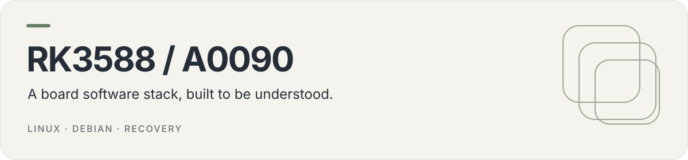

<p align="center">
  
</p>

# RK3588 / A0090

Build and maintenance sources for the AMedia RK3588 LP4 V10 board, also identified as A009/A0090. The repository brings together a pinned mainline Linux kernel, board device trees, firmware, a Debian 13 arm64 root filesystem and recovery documentation.

[Build](#build-workflow) · [Repository map](#repository-map) · [Recovery](#recovery-and-deployment) · [Runbook](RUNBOOK.md)

## What is here

| Layer         | Source                                                |
| ------------- | ----------------------------------------------------- |
| Kernel        | `KERNEL_TAG`, `configs/`, `patches/`, `kernel-extra/` |
| Board support | `dts/`, `fit/`, `firmware-blobs/`                     |
| Debian image  | `rootfs/` packages, hooks and overlay                 |
| Operations    | `scripts/`, `RUNBOOK.md` and `docs/`                  |

> [!IMPORTANT]
> This is board-specific build and operator tooling, not a general-purpose flashable release. Partition layouts, vendor boot components and firmware must match the target board. Historical reports describe an installation at that time; they are not a live hardware-status feed.

## Build workflow

The documented build host uses Fedora with an AArch64 cross-compiler, U-Boot tools, `dwarves`, ncurses/ELF development packages, QEMU user emulation, `debootstrap`, Git, rsync and zstd. Read the scripts and [runbook](RUNBOOK.md) before selecting paths or a target.

```sh
cat KERNEL_TAG
bash scripts/build-kernel.sh
bash scripts/build-fit.sh
```

The kernel script uses the pinned source tag and applies this repository's patches and device tree. The FIT script packages the resulting kernel, board DTB and required resources. Build paths are installation-specific; inspect their defaults before a new installation.

For the root filesystem, read [rootfs setup](docs/rootfs.md) before using `scripts/build-rootfs.sh`. Secret material is supplied separately; do not bake machine identities or network credentials into a public image.

## Recovery and deployment

Module staging and boot flashing are explicit operator steps, separate from building. `scripts/stage-modules.sh` and `scripts/flash-boot.sh` act on a device; review the SSH target (`HUB11`), build paths, partition layout and backups first. Flashing can reboot the target. The scripts' existing defaults are not portable configuration for another board.

Use [RUNBOOK.md](RUNBOOK.md) for backup/readback and maskrom recovery. Preserve a known-good boot image, loader and matching modules off-device before changing boot media. `scripts/verify-drivers.sh` provides post-boot hardware checks.

## Repository map

```text
configs/          Kernel configuration fragments
patches/          Kernel patch series
dts/              Board device trees
fit/              Boot image description
firmware-blobs/   Firmware and resource manifest
rootfs/           Debian image inputs
recovery-init/    Recovery initialization
scripts/          Build, staging, flash and verification scripts
docs/             Platform notes and historical reports
```

## Further reading

- [Root filesystem](docs/rootfs.md)
- [Desktop and audio](docs/desktop.md)
- [Wireless/AP limitations](docs/wlan1-ap.md)
- [SD storage notes](docs/sd-benchmark.md)
- [Private network setup](docs/tailscale.md)

Hardware validation requires the matching board. A documentation update or successful build does not establish that every peripheral works on a different device. No top-level project license file is present; check upstream component and firmware licensing before redistribution.
